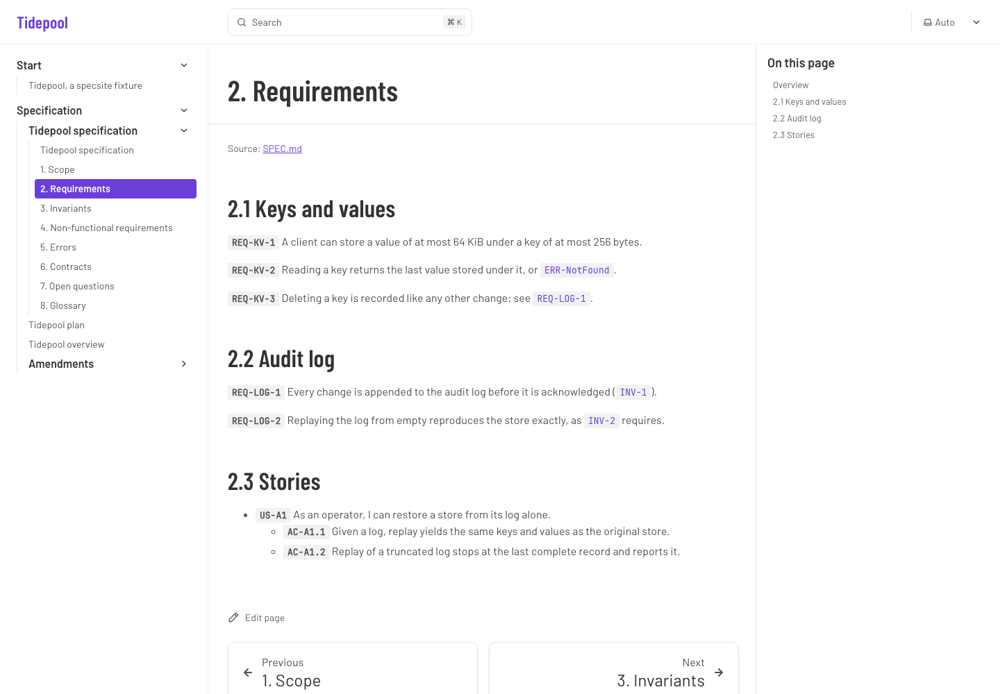
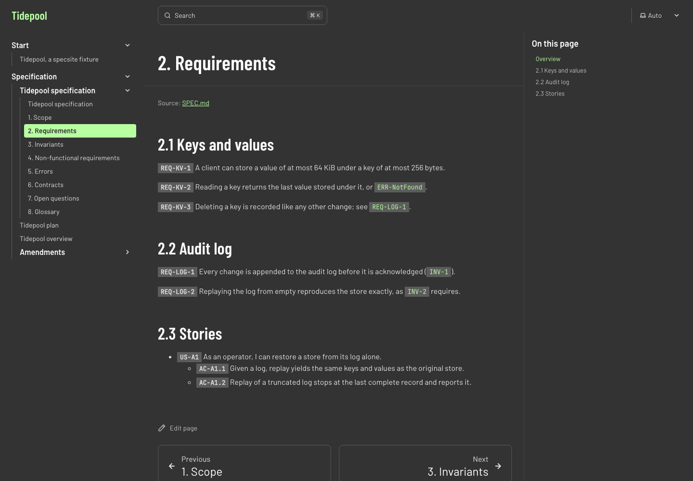
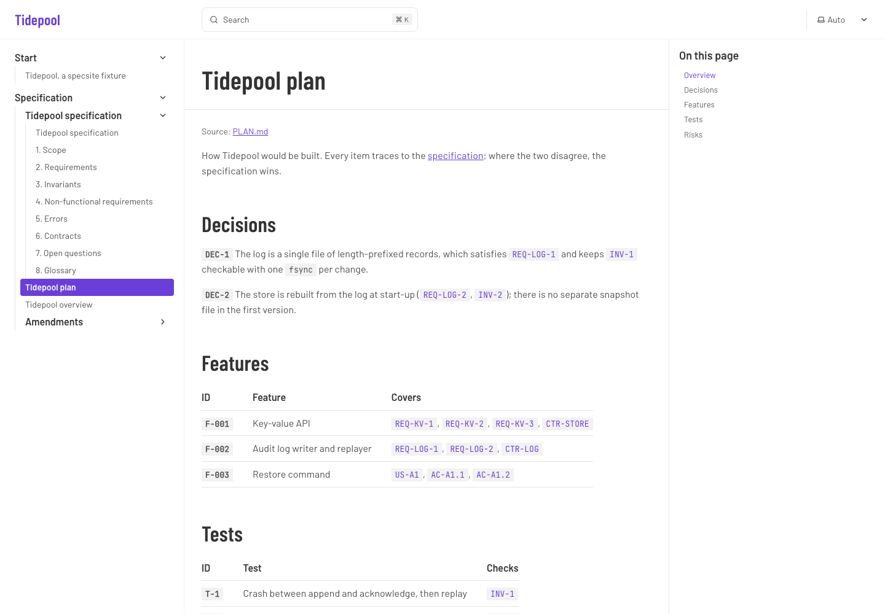
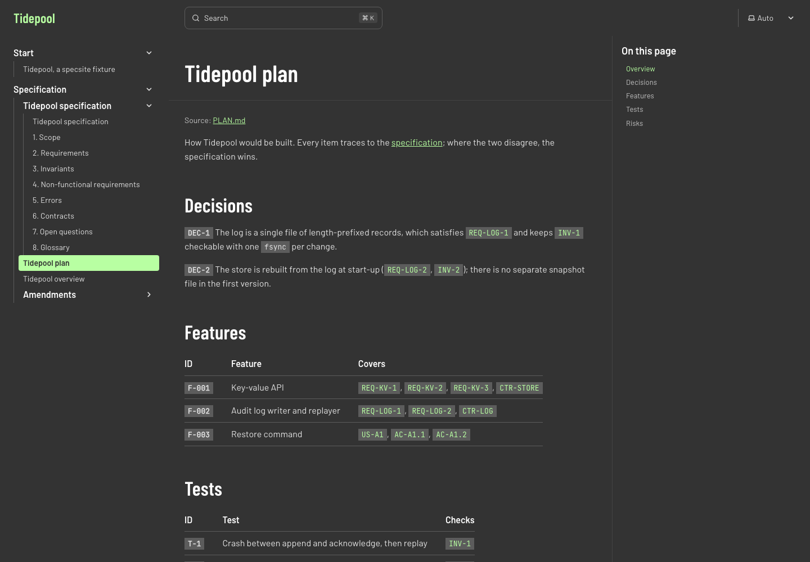

# specsite

*A Swimming on Code project.*

specsite publishes a repository's Markdown specs (`SPEC.md`, `PLAN.md`, `OVERVIEW.md`, `amendments/…`)
as living pages on a [Starlight](https://starlight.astro.build) docs site, and as single-file HTML
snapshots, from one pipeline. Requirement identifiers such as `REQ-AU-8` become anchors where they are
defined and links everywhere else, across pages and documents.

## Why

Spec-driven projects keep their source of truth in Markdown at the root of the repository. Publishing it
usually means copying it into the docs site, where it drifts. specsite reads the files where they are, at
build time, so the site is rebuilt from them on every merge and there is nothing to keep in sync. The same
pipeline writes a self-contained HTML page per document, for sharing while a repository is still private.

## The `.md` is the source of truth

- Pages are generated from the listed files at build time. Nothing is copied into `src/content/docs`,
  and nothing generated is committed.
- Only the files you list are read and published: the configuration is an allowlist.
- Each page opens with its basis: the repository, the commit the site was built from, the document's
  version and status, when it was rendered, and the commit that last changed the file. Its edit link opens
  that file, not a copy.
- Fix a page by editing the Markdown; the next build carries it everywhere it appears.

## Install

specsite is not on npm yet. Install it from GitHub (the `prepare` script builds it):

```sh
npm install github:swimmingoncode/specsite
```

It needs Node 22.12 or later, Astro 7 and Starlight 0.42 (it is built and tested with Astro 7.3.5 and
Starlight 0.42.4).

## Set up a Starlight site

Two places change. In `astro.config.mjs`, add the plugin with the list of documents:

```js
import starlight from '@astrojs/starlight';
import specsite from 'specsite';

export default defineConfig({
	integrations: [
		starlight({
			title: 'My project',
			sidebar: [/* your own groups */],
			plugins: [
				specsite({
					root: '..', // the docs site lives in site/, the documents at the repository root
					documents: [
						{ file: 'SPEC.md', slug: 'spec', title: 'Specification', split: 'h2' },
						{ file: 'PLAN.md', slug: 'plan' },
						{ file: 'OVERVIEW.md', slug: 'overview', defines: false },
						{ glob: 'amendments/*.md', slug: 'amendments', title: 'Amendments' },
					],
					ids: { prefixes: ['REQ', 'INV', 'NFR', 'OQ', 'DEF', 'DEC', 'ERR', 'US', 'AC', 'CTR', 'CND', 'T', 'F'], definitions: 'auto' },
					sidebar: { label: 'Specification' },
				}),
			],
		}),
	],
});
```

In `src/content.config.ts`, wrap Starlight's loader so the documents join the `docs` collection:

```ts
import { defineCollection } from 'astro:content';
import { docsLoader } from '@astrojs/starlight/loaders';
import { docsSchema } from '@astrojs/starlight/schema';
import { specsiteLoader } from 'specsite/loader';

export const collections = {
	docs: defineCollection({ loader: specsiteLoader(docsLoader()), schema: docsSchema() }),
};
```

That is all. `example/site` is a complete, working setup over an invented project.

### How it loads the Markdown

specsite adds the pages as entries of Starlight's own `docs` content collection, through Astro's content
layer: the loader reads each listed file, cuts it into pages, and renders each page with the site's own
Markdown processor (`renderMarkdown`), so heading anchors, asides, Expressive Code and the table of
contents behave exactly as on any other page. The rendered HTML then goes through specsite's pipeline
(identifiers and links, below) before it is stored. Because the pages are ordinary collection entries,
Starlight's sidebar, previous/next links, edit links, last-updated dates and Pagefind search all apply
unchanged, and nothing is written to disk.

## Configuration reference

| Option | Default | What it does |
| --- | --- | --- |
| `root` | `'.'` | Directory the document paths are relative to, from the Astro project root. |
| `documents` | (required) | The allowlist. Each entry is a file or a glob, see below. |
| `ids.prefixes` | the list above | Identifier families. An ID is `PREFIX-part[-part…]`, parts may contain `.` (`AC-A1.2`). |
| `ids.pattern` | from `prefixes` | A regular expression (source, no anchors) that replaces the built-in one. |
| `ids.definitions` | `'auto'` | `'auto'`, or the definition rules to use, in priority order: `'bold'`, `'table'`, `'heading'`, `'list'`. |
| `ids.linkText` | `true` | Also link IDs written as plain text, not only in `code`. |
| `repoUrl` | the `origin` remote, if on github.com | Base URL for edit links, the basis block and links to unpublished files; `false` turns them off. |
| `branch` | `'main'` | Branch for edit links and links to unpublished files. |
| `sidebar` | `{ label: 'Specification' }` | Group added to an explicit Starlight `sidebar` (`label`, `position: 'start' \| 'end'`, `collapsed`); `false` adds none. |
| `mermaid` | `true` | Render ` ```mermaid ` fences in the browser, from the site's own bundle, only on pages that have one. |
| `sourceLine` | `true` | Show the basis block at the top of each page: repository (`owner/name`), build commit (`HEAD`, linked), front-matter `spec_version`/`version` and `status`, ISO 8601 render time, and the commit that last changed the file. |
| `check` | `'warn'` | `'error'` fails the build on a reference to an undefined ID or a duplicate definition. |

A **file** document is `{ file, slug, title?, split?, defines? }`:

- `slug`: where it is published, e.g. `spec` → `/spec/`.
- `title`: default the front matter `title`, else the leading H1, else the file name.
- `split: 'h2'`: one page per H2 section (`/spec/<section-anchor>/`) plus an index page with the
  preamble and the list of sections. Sections keep their anchors: every heading keeps the GitHub anchor it
  has in the whole file (`#notes-1` stays `#notes-1`), and links to them, from any document, are
  rewritten to the page that holds them.
- `defines`: `true` (default), `false` (this document only refers to IDs), or a list of prefixes it may
  define (`['DEC', 'F']`).

A **glob** document is `{ glob, slug, title?, defines? }`: each match is one page under `slug`, e.g.
`amendments/0001-larger-values.md` → `/amendments/0001-larger-values/`.

## Identifiers

**Where an ID is defined.** In priority order, the first match wins across all documents (in the order
they are listed):

1. `bold`: `` **`REQ-KV-1`** `` at the start of a paragraph, list item or table cell;
2. `table`: `` `INV-1` `` (optionally bold) as the first cell of a table body row;
3. `heading`: `` `CTR-STORE` `` anywhere in a heading, or an ID that opens the heading text;
4. `list`: a list item that opens with `` `AC-A1.1` ``.

When a document is split at H2s, an ID in an H2 is defined by that section's page.

**Anchors.** A definition's anchor is the ID in lower case (`REQ-DI-4` → `#req-di-4`), on the page that
holds it, so any tool can deep-link to a requirement from its ID alone. The same holds in `specsite html`.

**Mentions.** Every other `` `REQ-KV-1` `` in inline code becomes a link to its definition, on the same
page, another page, or another document. With `linkText`, IDs in running text are linked too. Code blocks,
existing links and diagrams are left alone. A definition page ranks first in search for its ID.

**Problems.** An ID in inline code that nothing defines stays plain text and is reported, with each file and
line; so is an ID defined twice by the same rule, such as two bold definitions or two table rows (the
first wins, later ones become links). An ID that opens a list item or table row after a stronger definition
elsewhere, as in a traceability list, is a reference, not a duplicate. With `check: 'error'` either fails
the build.

## Links

- A relative link to a listed document (`[plan](PLAN.md)`, `SPEC.md#4-errors`) becomes its site URL,
  pointing into the right section page when the target is split.
- A relative link to any other file in the repository (`../LICENSE`, `src/lib.rs#L4`) becomes a link to
  that file on the repository host (`repoUrl`, `branch`); relative images become raw-file URLs.
- Absolute URLs and site-absolute paths are left as written.

## The HTML snapshot

```sh
specsite html SPEC.md -o out/spec.html --with PLAN.md=plan.html
```

writes one self-contained page: a contents rail beside one reading column, light and dark (following the
reader's setting, with a toggle), all CSS inline. The only external request is Google Fonts for the default
faces; `--no-google-fonts` removes it. Identifiers are anchored and linked exactly as on the site;
`--with <file>=<url>` lets mentions of another document's IDs link to where that document is published.
The header carries the same basis block as a site page (front-matter `date` is the author's and is not
shown as the render time).

| Flag | |
| --- | --- |
| `-o, --out <file>` | Output file (required). |
| `--title`, `--summary` | Override the front matter's `title` and `summary`. |
| `--brand <svg>`, `--brand-dark <svg>`, `--brand-label <text>` | A mark for the header, inlined, with an optional dark-theme variant. |
| `--accent <hex>` | Replace the default theme's accent. |
| `--with <file>=<url>` | Another document whose IDs this one links to (repeatable). |
| `--root <dir>` | Directory relative links may reach (default: the file's git repository). |
| `--repo-url <url>`, `--branch <name>` | For links to unpublished files. |
| `--prefixes <list>` | Comma-separated ID prefixes. |
| `--check <warn\|error>` | As `check` above; `error` exits non-zero. |
| `--toc-depth <2\|3>` | Headings in the contents rail. |

The default theme is Swimming on Code's; a project with its own identity passes `--brand` and `--accent`.

## Screenshots

The fixture in `example/`, a section page of its split specification and its plan, in light and dark:

| | |
| --- | --- |
|  |  |
|  |  |

## Roadmap

Not in v0.1:

- **Backlinks.** At each ID's anchor, list the decision items and amendments that reference it
  (`decisions/questions.json`, `decisions/responses/*.json`, `amendments/`).
- **Tombstones.** Keep withdrawn IDs resolvable: the anchor stays, saying which amendment withdrew it.
- **Traceability export.** A `needs.json`-compatible export (the sphinx-needs format), for interop with
  traceability tooling.

## Contributing

See [CONTRIBUTING.md](CONTRIBUTING.md) (commits are signed off under the DCO) and
[SECURITY.md](SECURITY.md).

## License

[MIT](LICENSE) © 2026 Pablo Dorado

---

<p>
  <a href="https://swimmingoncode.com">
    <picture>
      <source media="(prefers-color-scheme: dark)" srcset="docs/brand/swimming-on-code-wordmark-white.svg">
      
    </picture>
  </a>
</p>

specsite is a Swimming on Code project.
