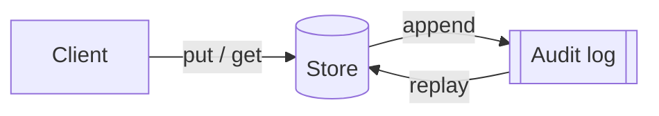

# Tidepool specification

Tidepool is an invented, deliberately tiny key-value store with an append-only audit log. It exists only
to exercise [specsite](https://github.com/swimmingoncode/specsite): every name and number in it is made up.

## 1. Scope

Tidepool stores small values under string keys, for one process at a time, and records every change in an
audit log that anyone holding the log can replay. Clustering and access control are out of scope (see
`OQ-1`). How it is built is in the [plan](PLAN.md); a short reading is in the [overview](OVERVIEW.md).

## 2. Requirements

### 2.1 Keys and values

**`REQ-KV-1`** A client can store a value of at most 64 KiB under a key of at most 256 bytes.

**`REQ-KV-2`** Reading a key returns the last value stored under it, or `ERR-NotFound`.

**`REQ-KV-3`** Deleting a key is recorded like any other change; see `REQ-LOG-1`.

### 2.2 Audit log

**`REQ-LOG-1`** Every change is appended to the audit log before it is acknowledged (`INV-1`).

**`REQ-LOG-2`** Replaying the log from empty reproduces the store exactly, as `INV-2` requires.

### 2.3 Stories

- `US-A1` As an operator, I can restore a store from its log alone.
  - `AC-A1.1` Given a log, replay yields the same keys and values as the original store.
  - `AC-A1.2` Replay of a truncated log stops at the last complete record and reports it.

## 3. Invariants

| ID | Invariant | Checked by |
| --- | --- | --- |
| `INV-1` | No acknowledged change is missing from the log. | `T-1` |
| `INV-2` | Store state is a pure function of the log. | `T-2` |

## 4. Non-functional requirements

| ID | Requirement |
| --- | --- |
| `NFR-1` | A `get` completes in under 1 ms at the 99th percentile on a laptop. |
| `NFR-2` | The log format is documented well enough to write a reader in another language. |

## 5. Errors

| Code | Meaning |
| --- | --- |
| `ERR-NotFound` | The key has no value. |
| `ERR-TooLarge` | The key or value exceeds the limits of REQ-KV-1. |

## 6. Contracts

### `CTR-STORE` Store interface

`put(key, value)`, `get(key)` and `delete(key)`, with the errors of [section 5](#5-errors).

### `CTR-LOG` Log record

One record per change: a sequence number, the operation, the key, and the value for `put`.

## 7. Open questions

| ID | Question |
| --- | --- |
| `OQ-1` | Should a later version add access control, and if so, per key or per store? |

## 8. Glossary

- `DEF-1` **Store**: the current mapping from keys to values.
- `DEF-2` **Log**: the ordered list of changes, see [the log contract](#ctr-log-log-record).

The fixture's own sources live in the [example directory][example]; the licence is in the repository's [LICENSE](../LICENSE).

[example]: ./site/README.md
